

  

<h1 align="center">NOIZ DEMONS</h1>

<b>Felucca mod by SPIKE the Percussionist</b> 
Ritual firmware for the M-VAVE FM-1

---

NOIZ DEMONS turns randomization on the FM-1 into a summoning. Every time you roll a new sound, one of **30 demons of the Ars Goetia** answers, its sigil takes over the screen, and its rank in the infernal hierarchy decides how far it's allowed to drag your sound away from where it was. A Knight barely touches it. A King tears it down to nothing and builds something new.

This guide assumes you already know your way around the FM-1 and stock [Felucca](https://github.com/hugelton/Felucca). It covers what's new.

  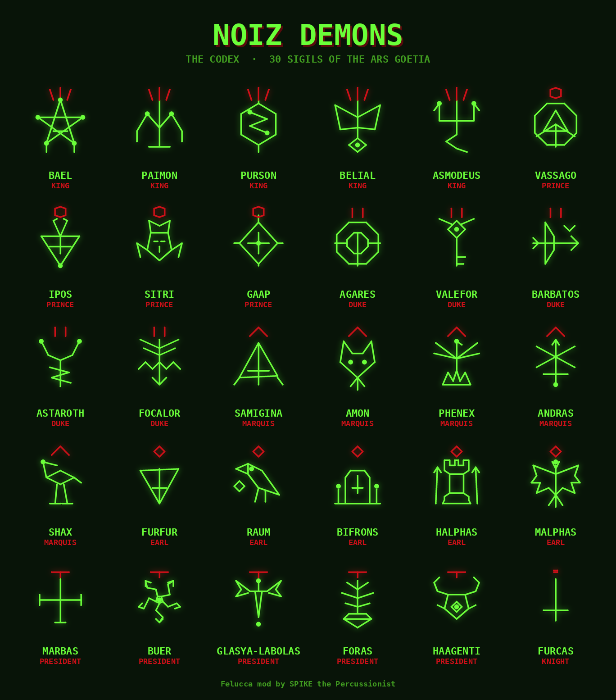

## Contents

- [Quick start](#quick-start)
- [Ritual](#ritual)
- [Summoning](#summoning)
- [The sigil](#the-sigil)
- [The hierarchy](#the-hierarchy)
- [The codex](#the-codex)
- [Installing](#installing)
- [Credits and license](#credits-and-license)

## Quick start

1. **Power on.** The NOIZ DEMONS splash plays. Press any button to skip it.
2. **You're already in Ritual.** Every track boots with Ritual on, and a demon's sigil is already watching in the graph area.
3. **Summon.** Hold **EDIT** and press the **SUM** key (black key 3). A demon answers, its sigil appears, and the sound changes.
4. **Summon again** as often as you like. The same demon never answers twice in a row.
5. **Don't like it?** Hold **SAVE** to undo back to the sound you had before.

## Ritual

Ritual is the mode that lets demons in. It's set **per track**.

- **Toggle it:** hold **EDIT** and press the **RIT** key (black key 1). The screen confirms with **RITUAL ON** or **RITUAL OFF**.
- **It's always on at power-up.** Every track starts in Ritual, every time. NOIZ DEMONS doesn't remember turning it off.
- **Ritual off** gives you the normal FM-1 back for that track: knobs edit values one step at a time, the stock graphs return, and the SUM key just tells you **RITUAL OFF**.

## Summoning

A summoning rerolls part of the track's sound, each value landing somewhere random within the reach the demon allows. There are two ways to summon, and both need Ritual on for the track.

**The SUM key** (hold EDIT, black key 3). What it rolls depends on where you are:

| Where you are | What gets summoned |
|:---|:---|
| HOME, or any other page | **Everything** on the track: the FM6 patch, ENV, LFO and FX, all under one demon |
| An FM6 operator page (OPERATOR, OPERATOR 2, OP ENV) | The whole FM6 patch: all six operators, algorithm, feedback and more |
| An ENV, LFO or FX page | That whole area (every page of that family) |

**Turning a knob** on an ENV, LFO, FX or FM6 operator page while Ritual is on also summons, and **every click of the knob is a new summoning** with a new demon. Spin slowly to audition demons one by one.

Good to know:

- **One gesture, one undo.** Hold **SAVE** to return to the sound from before you started summoning.
- **Summoned sounds are yours.** They save with presets and projects like any edit, and they're recorded as automation if you summon while armed and playing.
- **No silent patches.** On FM6, a summoning is never allowed to come out completely silent. Faint, strange and quiet sounds still get through, but dead air gets quietly rescued.
- **The keys always play notes.** On FM6, the operators you hear directly are always set to follow the keyboard after a summoning, so the pitch never freezes on one note. The other operators can still land on fixed frequencies, which is where the metallic, clangy tones come from. (If you change the ALG knob afterwards, a fixed operator can end up audible and freeze the pitch again; the next summoning fixes it.)
- **Shared effects pages** (DLY, REVERB, CHORUS) are shared by every track. A summoning there rolls only that page, and SAVE can't undo it.
- **SLICER is never summoned,** since its values can't be undone.
- **On FM6, the ENV area does nothing you'll hear,** because FM6 uses its own operator envelopes. Summon the operators instead.

## The sigil

While Ritual is on, the demon's sigil **replaces the graph area** on HOME and on every page. The waveform, envelope curves, LFO shapes and algorithm chart all give way to the sigil. Turn Ritual off to get them back.

- The **demon's name** sits top left and its **rank** top right.
- The **red mark** above each sigil also shows its rank at a glance (see [The hierarchy](#the-hierarchy)).
- The sigil **breathes with your sound**, swelling and glowing on every hit and easing back as it fades. It listens to the synth itself, before the master volume, so it keeps moving even with the volume all the way down.
- **Each track keeps its own demon.** Switch tracks and you'll see that track's sigil.

## The hierarchy

Every summoning first picks one of the seven ranks, **each equally likely**, then one of that rank's demons. Each demon then has its own **power**: a step on a ladder of 30, from Furcas at the bottom to Belial alone at the top, each step about 2.4% above the last. The ladder climbs rank by rank, so every demon is wilder than every demon of the rank beneath. Within a rank, the order comes from each demon's lore: violent and destructive demons stand higher, scholars and healers lower.

  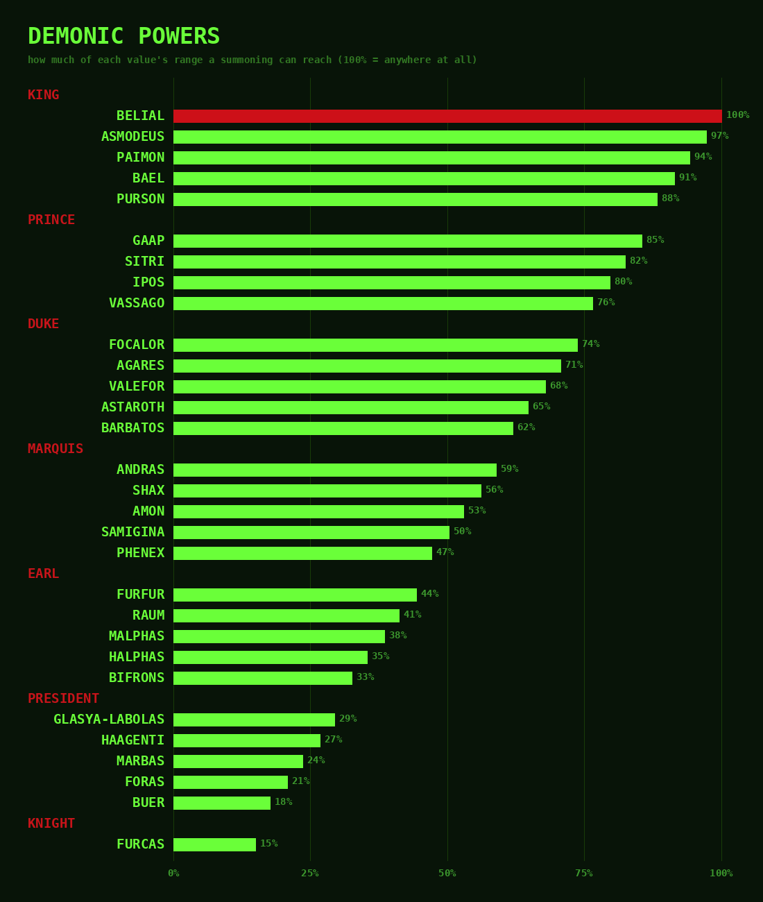

**Demonic Power** is how much of each value's range a summoning can reach. At 15%, a value moves only a little around where it already is. At 100%, it can land anywhere at all, and only Belial reaches it.

| Rank | Rank mark | Demons | Demonic Power |
|:---|:---|:---:|:---:|
| King | three red rays | 5 | 88 to 100% |
| Prince | a red hexagon | 4 | 76 to 85% |
| Duke | two red bars | 5 | 62 to 74% |
| Marquis | a red chevron | 5 | 47 to 59% |
| Earl | a red diamond | 5 | 33 to 44% |
| President | a red T-bar | 5 | 18 to 29% |
| Knight | a short red dash | 1 | 15% |

Because every rank is equally likely, rare ranks don't mean rare summonings. Furcas, the lone Knight, answers about one summoning in seven, while each of the five Kings answers about one in 35.

## The codex

Each demon, its traditional lore, and what it does to your sound, ordered from the top of the hierarchy down and, within each rank, from wildest to calmest.

### Kings

**Rank mark:** three red rays · **Demonic Power:** 88 to 100%

The top of the hierarchy. A King throws every value nearly anywhere in its range, and Belial anywhere at all. Expect a completely different sound. Each King answers about 1 summoning in 35.

| Sigil | Demon |
|:---:|:---|
|  | **Belial** · King · **100%** Created next after Lucifer, he arrives as two beautiful angels in a chariot of fire, the most lawless of the Kings. *Sound:* The only demon with no guardrails at all. Every value can land anywhere in its range. The sound you had is gone. |
| 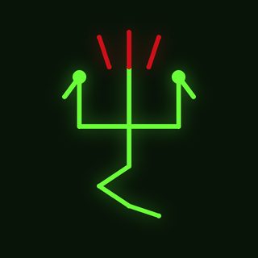 | **Asmodeus** · King · **97%** Three heads (bull, man and ram), a serpent's tail and fire on his breath. A King of wrath and ruin. *Sound:* One step below Belial. Nearly a clean slate every time, but the faintest pull back toward the old sound remains. |
| 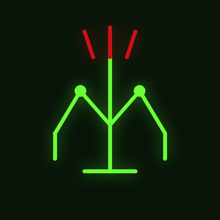 | **Paimon** · King · **94%** Obedient to Lucifer, he rides a dromedary in a roar of trumpets and teaches every art and science. *Sound:* Close to total chaos. Almost anything can happen. |
| 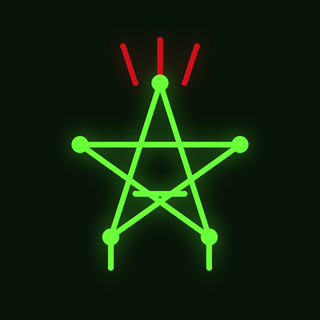 | **Bael** · King · **91%** The first King, ruling in the east, with the heads of a toad, a man and a cat. He makes men invisible. *Sound:* Near-total chaos, though a faint thread of the old sound can sometimes survive. |
| 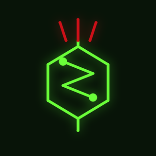 | **Purson** · King · **88%** Lion-faced, riding a bear and bearing a viper, heralded by trumpets. He speaks truly of hidden things. *Sound:* The calmest King, and still wilder than any Prince. A huge throw with a sliver of restraint. |

### Princes

**Rank mark:** a red hexagon · **Demonic Power:** 76 to 85%

Huge changes that occasionally leave a trace of the original. Each Prince answers about 1 summoning in 28.

| Sigil | Demon |
|:---:|:---|
| 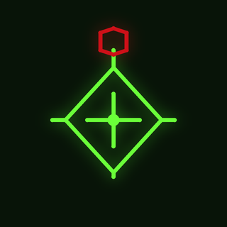 | **Gaap** · Prince · **85%** Comes when the sun is in the southern signs, stirs love and hatred, and carries men from kingdom to kingdom. *Sound:* The wildest Prince, pressing right up against the Kings. |
|  | **Sitri** · Prince · **82%** A leopard's head and griffin's wings. He inflames love and lays secrets bare. *Sound:* Leans wild. Big moves with a heated edge. |
|  | **Ipos** · Prince · **80%** An angel with a lion's head, goose's feet and a hare's tail. He makes men witty and bold. *Sound:* The middle of the Princes. Bold, but not reckless. |
| 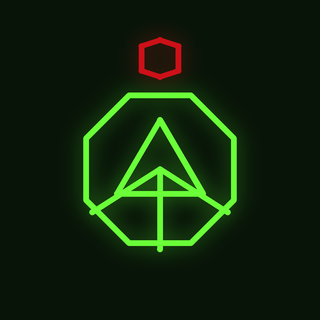 | **Vassago** · Prince · **76%** A Prince "of a good nature," who tells of past and future and finds what has been lost. *Sound:* The calmest Prince. A big transformation that still remembers where it came from. |

### Dukes

**Rank mark:** two red bars · **Demonic Power:** 62 to 74%

Strong rewrites. The patch's character changes, though its skeleton often survives. Each Duke answers about 1 summoning in 35.

| Sigil | Demon |
|:---:|:---|
| 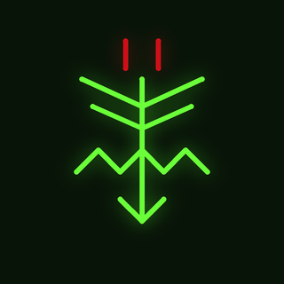 | **Focalor** · Duke · **74%** A man with griffin's wings who commands wind and sea, drowns men and overturns warships. *Sound:* The wildest Duke. Stormy and destructive. |
| 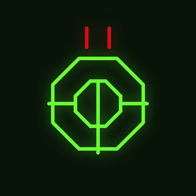 | **Agares** · Duke · **71%** An old man on a crocodile with a goshawk on his fist. He brings back runaways and causes earthquakes. *Sound:* Leans wild. The ground shifts under the patch. |
| 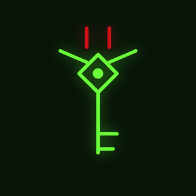 | **Valefor** · Duke · **68%** A lion with an ass's head, a good familiar who tempts men to steal. *Sound:* The middle of the Dukes. Steals a lot, leaves a little. |
| 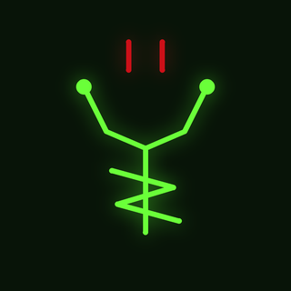 | **Astaroth** · Duke · **65%** Rides an infernal dragon with a viper in hand. He answers truly of past, present and future. *Sound:* Leans calm. A strong rewrite with some memory of the past. |
| 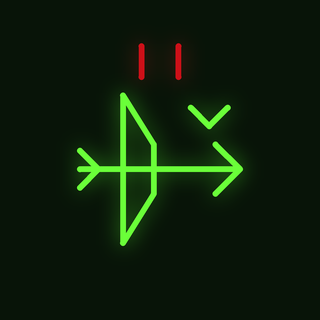 | **Barbatos** · Duke · **62%** Understands the songs of birds and the barking of dogs, and reconciles friends. *Sound:* The calmest Duke. A substantial change that keeps the patch's bones. |

### Marquises

**Rank mark:** a red chevron · **Demonic Power:** 47 to 59%

The middle of the order. Each value can wander about half its range. Each Marquis answers about 1 summoning in 35.

| Sigil | Demon |
|:---:|:---|
| 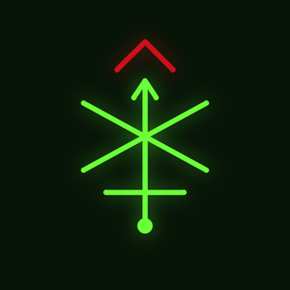 | **Andras** · Marquis · **59%** An angel with a raven's head, riding a black wolf, sword in hand. He sows discord. *Sound:* The wildest Marquis, causing trouble well above his station. |
| 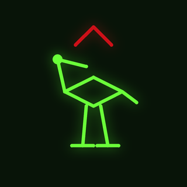 | **Shax** · Marquis · **56%** A stock-dove with a hoarse voice who takes away sight, hearing and understanding. *Sound:* Leans wild. Strips things away. |
|  | **Amon** · Marquis · **53%** A wolf with a serpent's tail, breathing flame. He tells of past and future and reconciles friends. *Sound:* The middle of the Marquises. Fiery, but fair. |
| 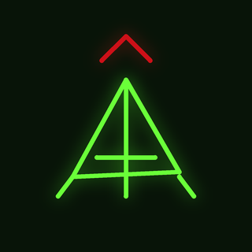 | **Samigina** · Marquis · **50%** A small horse or donkey who teaches the liberal sciences and gives account of the souls of the drowned. *Sound:* Leans calm. A studied, middling change. |
| 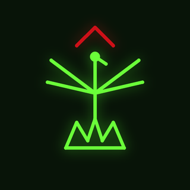 | **Phenex** · Marquis · **47%** A phoenix singing with a child's sweet voice, a poet who hopes one day to return to the Seventh Throne. *Sound:* The calmest Marquis. Reworks the sound gently, rising from what was there. |

### Earls

**Rank mark:** a red diamond · **Demonic Power:** 33 to 44%

Clear changes that stay in the neighborhood of the sound you had. Each Earl answers about 1 summoning in 35.

| Sigil | Demon |
|:---:|:---|
| 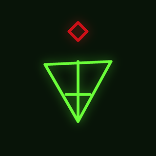 | **Furfur** · Earl · **44%** A hart with a fiery tail, a liar outside the triangle, who raises thunder, lightning and storms. *Sound:* The wildest Earl. Weather moves in. |
| 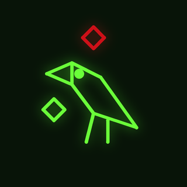 | **Raum** · Earl · **41%** A crow who steals treasure from the houses of kings and destroys cities. *Sound:* Leans wild. Takes more than he leaves. |
|  | **Malphas** · Earl · **38%** A crow, then a man, who builds houses and towers and throws down the walls of enemies. *Sound:* The middle of the Earls. Builds and destroys in equal measure. |
| 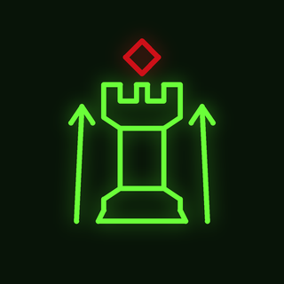 | **Halphas** · Earl · **35%** A stock-dove who builds towers, fills them with weapons, and sends men to war. *Sound:* Leans calm. Fortifies the sound more than it razes it. |
| 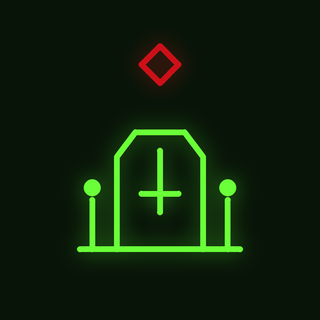 | **Bifrons** · Earl · **33%** A monster who becomes a man, teaching astrology and geometry and moving the dead from grave to grave. *Sound:* The calmest Earl. Quietly rearranges things. |

### Presidents

**Rank mark:** a red T-bar · **Demonic Power:** 18 to 29%

Mutations, not replacements. Good for refining a sound you mostly like. Each President answers about 1 summoning in 35.

| Sigil | Demon |
|:---:|:---|
| 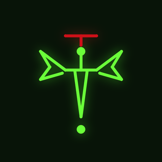 | **Glasya-Labolas** · President · **29%** A dog with griffin's wings, "author of bloodshed," who teaches every art in an instant. *Sound:* The wildest President. Pushes harder than his rank-mates. |
| 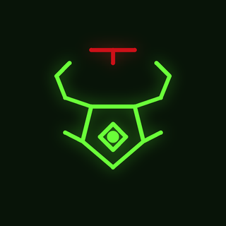 | **Haagenti** · President · **27%** A bull with griffin's wings who turns metal into gold and water into wine. *Sound:* Leans wild. Transmutes rather than tweaks. |
| 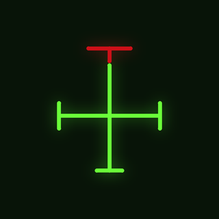 | **Marbas** · President · **24%** A great lion who reveals hidden things, causes and cures disease, and changes men's shapes. *Sound:* The middle of the Presidents. A shape-shift you can still recognize. |
| 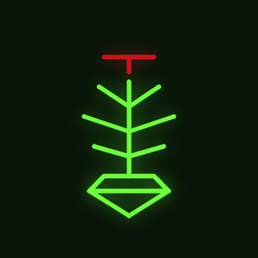 | **Foras** · President · **21%** A strong man who teaches logic, the virtues of herbs and stones, and grants long life. *Sound:* Leans calm. Measured, sensible moves. |
| 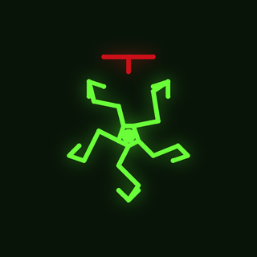 | **Buer** · President · **18%** A wheel of goat's legs around a lion's head, teaching philosophy and healing the sick. *Sound:* The calmest President. Small, healing adjustments. |

### Knight

**Rank mark:** a short red dash · **Demonic Power:** 15%

Only one Knight answers, and he only nudges. Furcas answers about 1 summoning in 7, more often than any other demon.

| Sigil | Demon |
|:---:|:---|
| 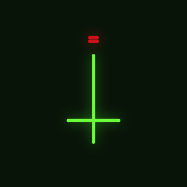 | **Furcas** · Knight · **15%** An old man with a long white beard on a pale horse, a sharp weapon in hand, teaching philosophy, astronomy and logic. *Sound:* The gentlest demon of all. Nudges each value a little around where it is: a variation, not a new sound. |

## Installing

NOIZ DEMONS builds and flashes the same way as stock [Felucca](https://github.com/hugelton/Felucca).

1. **Build** the firmware (`felucca.fwsc`) with the usual Felucca toolchain: Docker, the JieLi toolchain and the AC79 SDK, plus a Python virtual environment for the font step.
2. **Connect** the FM-1 over USB.
3. **Flash** it with `tools/fm1_install.py`, which sends the firmware over USB-MIDI. Its Python environment needs `mido` and `python-rtmidi`.
4. **Power cycle** the FM-1. If you see the NOIZ DEMONS splash, the ritual is complete.

## Credits and license

**NOIZ DEMONS** is a mod by **SPIKE the Percussionist** of [**Felucca**](https://github.com/hugelton/Felucca), the FM-1 firmware by Leo Kuroshita (@kurogedelic), Hügelton Instruments.

Like Felucca, it is released under the **GNU General Public License v3.0** (GPL-3.0-only).

Demon names, ranks and lore are drawn from the *Ars Goetia*, the first book of the 17th-century grimoire *The Lesser Key of Solomon*. The sigils are original stylized designs made for the FM-1's screen, not traced seals.
